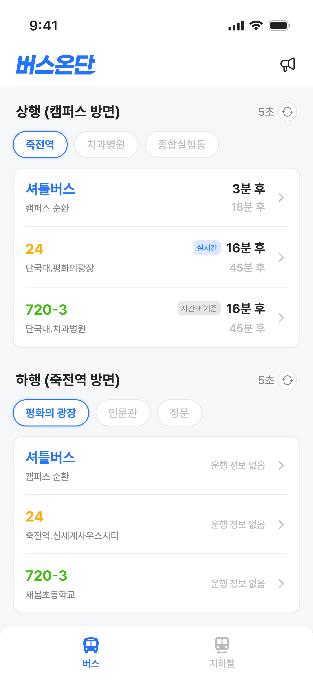
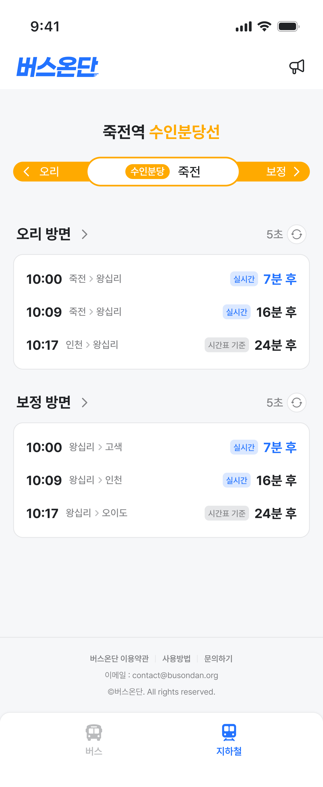
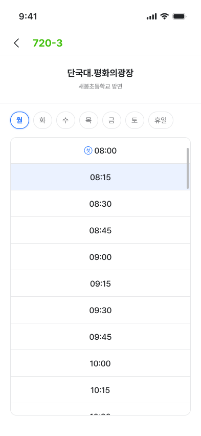
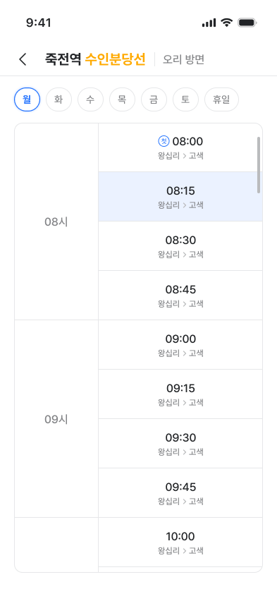

# 🚌 버스온단 (BusOnDan)

### 캠퍼스의 이동을 더 편리하게, 더 정확하게

**"우리 학교 버스, 언제 오는지 한눈에!"**

교내 셔틀버스부터 시내버스, 지하철까지  
캠퍼스 이동에 필요한 교통 정보를 하나의 서비스에서 제공합니다.

 

 

---

## 💙 About 버스온단

**기다림은 줄이고, 캠퍼스의 이동은 더 편리하게.**

대학 캠퍼스에서는 셔틀버스와 시내버스, 지하철 등 다양한 교통수단을 이용하지만, 각각의 운행 정보를 확인하기 위해 여러 서비스를 찾아봐야 하는 불편함이 있습니다.

버스온단(BusOnDan)은 이러한 불편을 해결하기 위해 개발한 **캠퍼스 맞춤형 통합 대중교통 정보 서비스**입니다.

교내 셔틀버스와 주변 시내버스의 도착 정보를 한눈에 확인하고, 지하철 운행 정보까지 함께 제공하여 보다 편리한 이동을 지원합니다.

정류장과 이동 방향에 따른 도착 예정 시간, 실시간 정보와 시간표 기반 정보를 구분하여 사용자가 필요한 교통 정보를 빠르게 확인할 수 있도록 구성했습니다.

 

## 📱 Service Preview

### 캠퍼스 이동을 위한 모든 교통 정보를 한곳에

 

<table>
  <tr>
    <td align="center"><b>시작 화면</b></td>
    <td align="center"><b>버스 도착 정보</b></td>
    <td align="center"><b>지하철 운행 정보</b></td>
  </tr>
  <tr>
    <td></td>
    <td></td>
    <td></td>
  </tr>
  <tr>
    <td align="center">서비스 시작</td>
    <td align="center">셔틀 및 시내버스 조회</td>
    <td align="center">방향별 지하철 도착 정보</td>
  </tr>
</table>

 

<table>
  <tr>
    <td align="center"><b>버스 운행시간표</b></td>
    <td align="center"><b>지하철 운행시간표</b></td>
  </tr>
  <tr>
    <td></td>
    <td></td>
  </tr>
  <tr>
    <td align="center">요일별 버스 운행시간 확인</td>
    <td align="center">요일 및 방향별 지하철 시간표</td>
  </tr>
</table>

 

## ✨ Key Features

| 기능 | 설명 |
|:---|:---|
| 🚌 **셔틀버스 정보 제공** | 교내 셔틀버스의 정류장별 운행 정보를 확인합니다. |
| 🚏 **실시간 버스 도착 정보** | 캠퍼스 주변 시내버스의 도착 예정 시간을 조회합니다. |
| 🚇 **지하철 운행 정보** | 캠퍼스 인근 지하철역의 방향별 운행 정보를 제공합니다. |
| 📅 **요일별 운행시간표** | 요일과 운행 방향에 따라 버스 및 지하철 시간표를 확인합니다. |
| 🔄 **교통 정보 갱신** | 최신 도착 정보를 주기적으로 확인할 수 있도록 지원합니다. |
| 📱 **통합 교통 정보 UI** | 여러 교통수단의 정보를 모바일 환경에서 직관적으로 제공합니다. |

 

## 🛠 Tech Stack

### Frontend

### Backend

### Database & Infrastructure

### Data Processing

 

## 📂 Project Structure

| Directory | Description |
|:---|:---|
| [BE](https://github.com/chae-ring/busondan_dku/tree/main/BE) | Spring Boot 기반 교통 정보 API 및 데이터 처리 |
| [FE/app](https://github.com/chae-ring/busondan_dku/tree/main/FE/app) | React Native 기반 모바일 애플리케이션 |
| [FE/web](https://github.com/chae-ring/busondan_dku/tree/main/FE/web) | React 기반 웹 프론트엔드 |
| [utils](https://github.com/chae-ring/busondan_dku/tree/main/utils) | 교통 데이터 수집 및 가공 유틸리티 |
| [dataset](https://github.com/chae-ring/busondan_dku/tree/main/dataset) | 교통 관련 데이터셋 |

 

## 👥 Our Team

### Team BusOnDan

**더 편리한 캠퍼스 이동을 만들어갑니다.**

 

<table>
  <tr>
    <th align="center">Role</th>
    <th align="center">GitHub ID / Name</th>
  </tr>
  <tr>
    <td align="center">Frontend (App & Web)</td>
    <td align="center">chae-ring</td>
  </tr>
  <tr>
    <td align="center">Backend</td>
    <td align="center">Kim-Taehyeong</td>
  </tr>
  <tr>
    <td align="center">Designer</td>
    <td align="center">Kim Ayoung</td>
  </tr>
</table>

 

---

### 🚌 버스온단 (BusOnDan)

**캠퍼스의 모든 이동을 더 스마트하게.**

